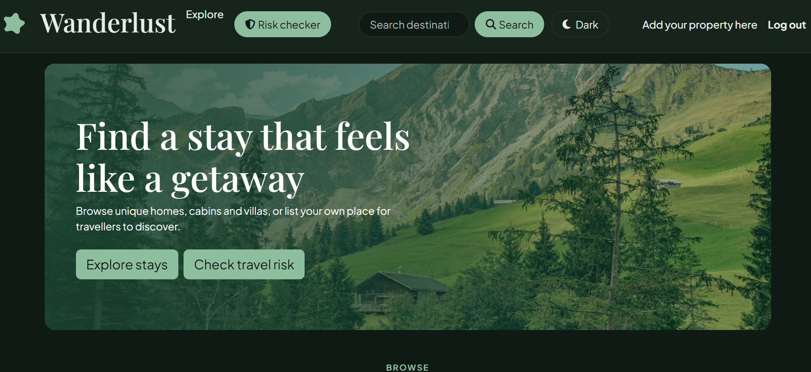
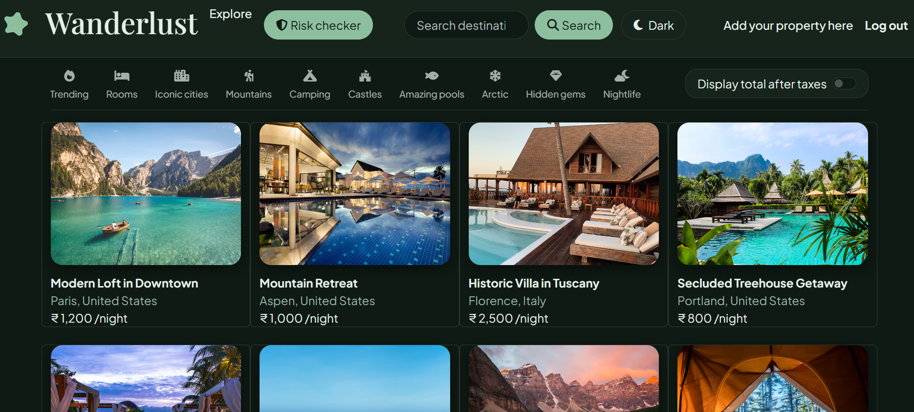
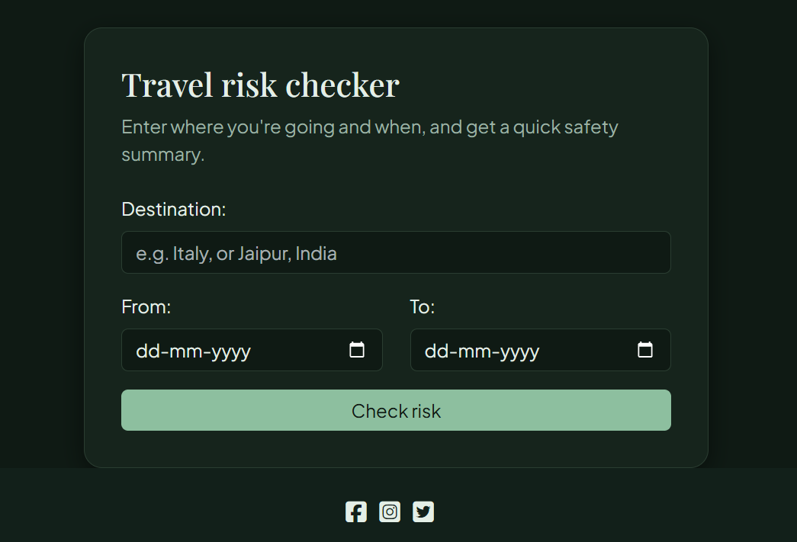

# Wanderlust

A full-stack travel-stay site where people can browse, host and review places to stay, with a map for every listing and a travel risk checker to help plan a trip.

**Live site:** https://wanderlust-kwn6.onrender.com
*(Hosted on a free plan, so the first load after a quiet period can take up to a minute.)*



## Features

- **Listings:** create, view, edit and delete listings with photo upload.
- **Search and filters:** search by title, location or country, and filter by category (Mountains, Camping, Castles and more). Both work together.
- **Maps:** every listing shows its location on an interactive Mapbox map. Locations are geocoded when you create a listing and again when you edit one.
- **Reviews:** star ratings and comments. Only a review's author can edit or delete it.
- **Authentication:** sign up, log in and log out with Passport, and owner-only controls on listings.
- **Travel risk checker:** enter a destination and travel dates to get a risk level, seasonal notes for those dates and general safety tips.
- **Light and dark theme:** a toggle that remembers your choice between visits.
- **Responsive design:** works on phones, tablets and desktops.
- **Price display:** a toggle to show prices with GST added.



## About the risk checker



The checker uses hand-written guidance stored in the project (`utils/riskData.js`), covering base risk, seasonal conditions and common-sense tips for a set of countries. It is **general guidance, not a live safety advisory**, and the results page links to official government travel advice. Always check official sources before you travel.

## Tech stack

| Area | Tools |
|---|---|
| Server | Node.js, Express |
| Database | MongoDB Atlas, Mongoose |
| Views | EJS, ejs-mate, Bootstrap 5 |
| Auth | Passport (local), passport-local-mongoose, express-session, connect-mongo |
| Uploads | Multer, Cloudinary |
| Maps | Mapbox GL JS, Mapbox Geocoding |
| Validation | Joi |
| Hosting | Render |

## Project structure

```
Controllers/   request handlers for listings and reviews
init/          seed script and sample data
models/        Mongoose schemas (Listing, Review, User)
public/        CSS, client-side JS and images
routes/        Express routers (landing, listings, reviews, users, risk checker)
utils/         helpers (error handling, risk data)
views/         EJS templates
app.js         app setup and middleware
middleware.js  login, ownership and validation checks
schema.js      Joi validation schemas
cloudConfig.js Cloudinary setup
```

## Run it locally

**You will need:** Node.js 22, a MongoDB Atlas cluster, a Cloudinary account and a Mapbox token.

1. Clone the repository and install packages:
   ```
   git clone https://github.com/AnujaShelke18/wanderlust.git
   cd wanderlust
   npm install
   ```
   A `.npmrc` file in the project handles a peer-dependency conflict, so a plain `npm install` works.

2. Create a `.env` file in the project root:
   ```
   ATLASDB_URL=your_mongodb_connection_string
   SECRET=a_long_random_string
   MAP_TOKEN=your_mapbox_token
   CLOUD_NAME=your_cloudinary_cloud_name
   CLOUD_API_KEY=your_cloudinary_api_key
   CLOUD_API_SECRET=your_cloudinary_api_secret
   ```

3. Start the app and register a user in the browser:
   ```
   npm start
   ```

4. *(Optional)* Add sample listings. The seed script assigns them to the first registered user, and it **deletes all existing listings** first:
   ```
   node init/index.js
   ```

5. Open http://localhost:8080.

## Deployment

Deployed on Render as a web service, with the same environment variables set in the dashboard plus `NODE_ENV=production`. MongoDB Atlas network access allows connections from Render.

## What I learned

- Building a full-stack app with the MVC pattern in Express.
- Session-based authentication and authorization, including owner-only actions.
- Working with external services: Cloudinary uploads, Mapbox geocoding and maps.
- Server-side validation, safe handling of user input, and error handling.
- Designing a theme system with CSS variables, and responsive layouts.
- Deploying and debugging a production app.
- I used $regex filters and had to escape user input, because a stray ( crashed the search ).

## Ideas for next steps

- City-level support in the risk checker.
- Average star rating on listing cards.
- Optional live data from a travel advisory source.
- Booking and availability.

## Author

Built by [@AnujaShelke18](https://github.com/AnujaShelke18).